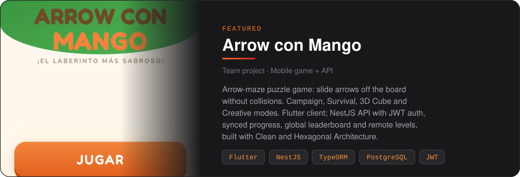

  &nbsp;&nbsp;
  &nbsp;&nbsp;
  

### About

Full Stack Developer based in Venezuela. I build web platforms end to end: React and TypeScript interfaces, REST APIs with NestJS and FastAPI, and PostgreSQL underneath. I care about clean architecture, shipping to production, and interfaces that feel considered.

### Featured

<a href="https://github.com/a-granadillo/ArrowConMango_Front">Frontend</a> &nbsp;&middot;&nbsp;
<a href="https://github.com/a-granadillo/ArrowConMango_Backend">Backend</a> &nbsp;&middot;&nbsp;
<a href="https://hetairoii.github.io/meet-hetairoii/">More work on my portfolio</a>

### Commit forest

One column per week. Bare ground: no commits &middot; a macaw: a few &middot; a tree: many, and the more commits, the taller it grows. Regenerated daily.

